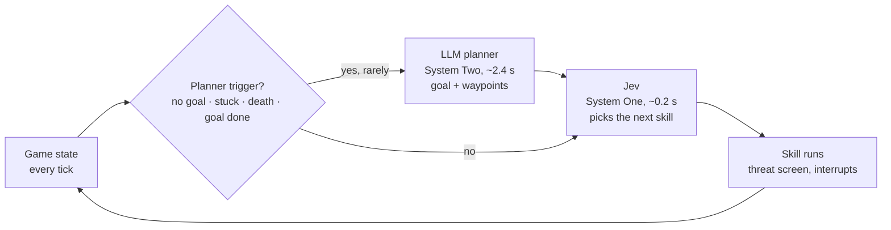
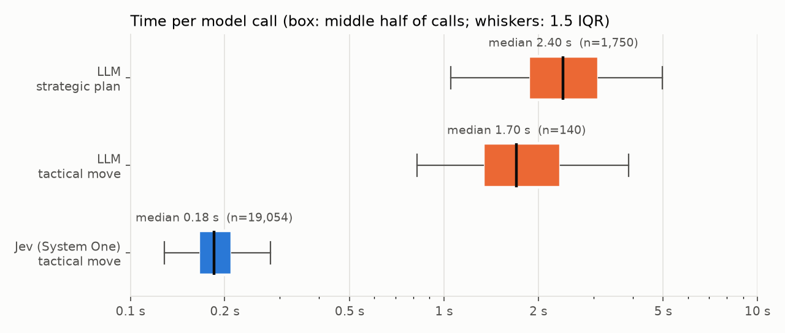
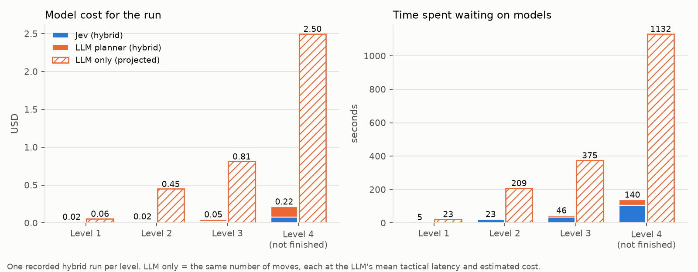
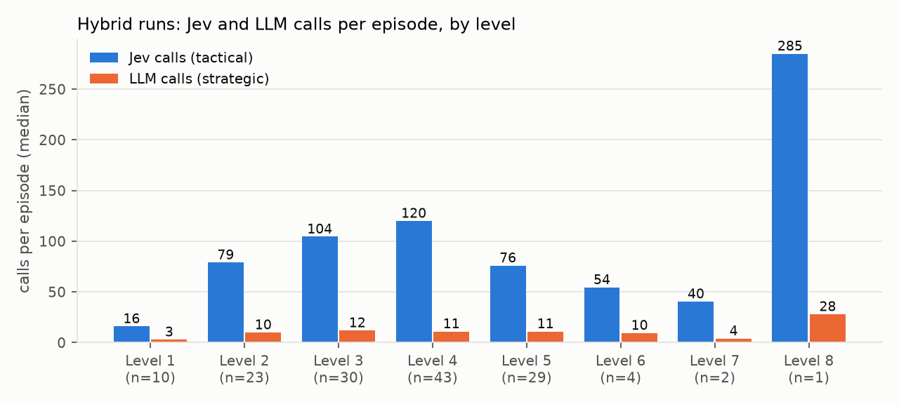
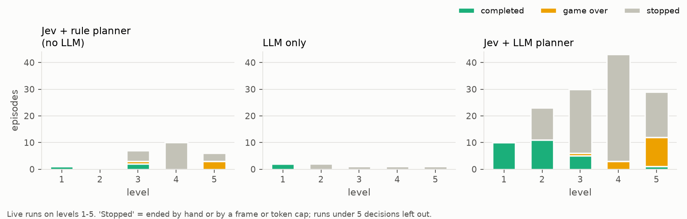

# System One Model: Jev and an LLM Playing Dangerous Dave

[](https://youtu.be/BTC-Yh-b1bk)

*Click the image to watch the demo on YouTube.*

A Python research harness that plays *Dangerous Dave* (1990) through the open-source
[deadly-dave](https://github.com/skoperst/deadly-dave) reimplementation, reading the game's real
state every tick. It compares two kinds of controller:

- **An LLM** (Azure OpenAI), slow and deliberate: "System Two".
- **TypeSafe's Jev** (via OpenRouter), a fast System One model that picks from a short list of options in about 0.2 s.

The planner, observations, memory and action interface stay the same for both, and both models get
exactly the same request. Any difference in play comes from the model. The write-up is in
[docs/article.md](docs/article.md).

## How it works



- **Strategic (LLM).** Chooses the goal (get the trophy, take the jetpack first, explore right) and
  up to five waypoints over a learned world graph. It is called only on events such as no goal,
  stuck, a death or a finished goal ([docs/planner.md](docs/planner.md)).
- **Tactical (Jev).** Every time a skill ends, Jev picks the next calibrated skill (`move_right_3`,
  `jump_left_4`, `shoot`, …). A physics check screens each option for danger first
  ([docs/skills.md](docs/skills.md), [docs/tactical.md](docs/tactical.md)).

The models never press keys directly. See [docs/architecture.md](docs/architecture.md) for the control loop.

## Results at a glance

These numbers come from 173 recorded live episodes (`artifacts/live.sqlite`). They are development
data, not a benchmark. See [docs/article.md](docs/article.md) for the full analysis and its limits.

| | Jev (System One) | LLM tactical move | LLM strategic plan |
|---|---|---|---|
| Calls recorded | 19,054 | 140 | 1,750 |
| Median latency | **0.18 s** | 1.70 s | 2.40 s |
| 90th percentile | 0.25 s | 3.36 s | 4.03 s |
| Cost per call | **$0.00012** | ~$0.0046 (est.) | ~$0.0094 (est.) |

**Time per model call.** Per move, the LLM is about 10× slower than Jev and about 40× more expensive.



**Cost and time per level.** Recorded hybrid runs compared with a *projection* that gives every Jev
move to the LLM instead. On level 4, Jev spent under 2 minutes thinking; the LLM would need about 19.



**Calls per level.** In the hybrid, Jev makes most of the decisions and the LLM is asked only a
handful of times per level.



**Outcomes.** The hybrid finished level 1 in 10 of 10 runs, level 2 in 11 of 23, level 3 in 5 of 30
and level 5 once. Most "stopped" episodes were stopped by hand during development.



To regenerate the charts and `docs/images/numbers.json`, run:

```bash
uv run --with matplotlib python scripts/article_figures.py --store artifacts/live.sqlite --out docs/images
```

## Requirements

- Windows (the game bridge is built with `scripts\setup_dave.bat`)
- Python 3.13 and [uv](https://docs.astral.sh/uv/)
- git and Visual Studio Build Tools 2022, to build deadly-dave and the bridge
- Node.js, for the viewer in `frontend/`
- API keys for live (paid) runs: OpenRouter for Jev, Azure OpenAI for the LLM

## Setup

The virtual environment is `jev/`. Point uv at it before running any `uv` command; otherwise uv creates a separate `.venv/`.

```powershell
# PowerShell
$env:UV_PROJECT_ENVIRONMENT="jev"
# Git Bash: export UV_PROJECT_ENVIRONMENT=jev

uv sync                    # installs dependencies and dave_agent (editable)
copy .env.example .env     # then fill in the keys below
scripts\setup_dave.bat     # clone, patch and build deadly-dave + bridge
```

`.env` needs these variables:

```
OPENROUTER_API_KEY=
AZURE_OPENAI_ENDPOINT=
AZURE_OPENAI_API_KEY=
AZURE_OPENAI_API_VERSION=
AZURE_OPENAI_CHAT_DEPLOYMENT=
```

Never commit `.env`. Offline tests and mock runs work without any keys.

## Quick start

There are three **arms**: **A** uses the Azure LLM for tactical moves, **B** uses Jev, and **C**
uses Jev plus the learned world graph.

Free and offline:

```powershell
uv run pytest                                   # offline test suite
uv run pytest -m "not dave"                     # skip real-game tests
uv run dave-agent play --arm A                  # one fixture episode with mock models
uv run dave-agent play --arm A --mock --adapter dave --scenario level1 --watch   # real game in a window
uv run dave-agent benchmark --arms A,B,C --trials 3                              # mock benchmark
```

**Live and paid** (calls Azure and/or Jev):

```powershell
uv run dave-agent play --arm B --planner live --tactical live --adapter dave --scenario level1
uv run dave-agent probe-provider --provider jev     # one Jev call
uv run dave-agent probe-provider --provider azure   # one planner call
```

Viewers:

```powershell
# Live viewer: watch the game and every decision as it happens
uv run dave-agent live            # add --allow-paid to let the page start live runs
cd frontend; npm install; npm run dev   # open http://localhost:3000/live

# Decision inspector: rebuild what the models saw at each decision
uv run dave-agent inspect --store artifacts/live.sqlite --run-id RUN
```

[docs/development.md](docs/development.md) has the full command reference: export, replay,
calibration, route search, warm-memory training and more.

## Configuration

- `configs/experiments.yaml` is the entry point. `environment.yaml`, `models.yaml` and `skills.yaml` are merged into it.
- `configs/skills.yaml` holds the calibrated skill catalogs, one per adapter.
- `configs/benchmark_dave.yaml` has Dave-scale settings for benchmarks on the real game.
- `configs/watch.yaml` has a longer frame cap and wall-time budget for watching whole levels.
- Secrets live in `.env`.

## Repository layout

| Path | Contents |
|---|---|
| `src/dave_agent/` | The harness package and the `dave-agent` CLI |
| `configs/` | Experiment, model, skill and benchmark settings |
| `scripts/` | Setup, probes, calibration, route search, article figures |
| `tests/` | Unit tests, fixtures, and live/real-game tests (marked `live` / `dave`) |
| `frontend/` | Next.js viewer for live runs and inspection bundles |
| `bridge/` | The patch applied to deadly-dave (`deadly-dave-bridge.patch`) |
| `external/` | The cloned deadly-dave source (gitignored) |
| `implementation/` | The phased specification |
| `docs/` | Detailed documentation and charts |

## Documentation

Start with [docs/progress.md](docs/progress.md) for the current status.

- [architecture.md](docs/architecture.md): the control loop and the role of each module
- [development.md](docs/development.md): environment, the full command reference and configuration
- [feasibility.md](docs/feasibility.md): game edition, mechanics, bridge design, Jev contract
- [skills.md](docs/skills.md): skill catalog, legal-action masks, interruption
- [planner.md](docs/planner.md): strategic planner and goal manager
- [tactical.md](docs/tactical.md): tactical controllers, validation, fallback, budgets
- [memory.md](docs/memory.md): working memory, episode store, export and replay
- [graph.md](docs/graph.md): the learned world graph and routes
- [benchmark.md](docs/benchmark.md): benchmark protocol, metrics, paid-run ceiling
- [inspector.md](docs/inspector.md): the decision inspector and read-only viewer
- [live.md](docs/live.md): the live viewer
- [state_mapping.md](docs/state_mapping.md): deadly-dave C fields mapped to observations
- [jev-apis.md](docs/jev-apis.md): Jev via OpenRouter, request shapes and config
- [article.md](docs/article.md): the draft article with the charts above
- [notebook.md](docs/notebook.md): the early Jev experiments in `test.ipynb`

See [AGENTS.md](AGENTS.md) for the style, commit and security conventions.
